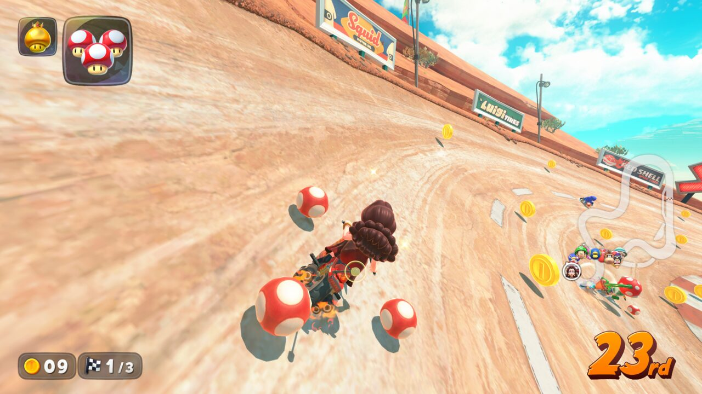
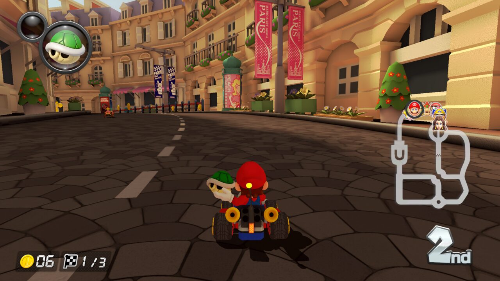
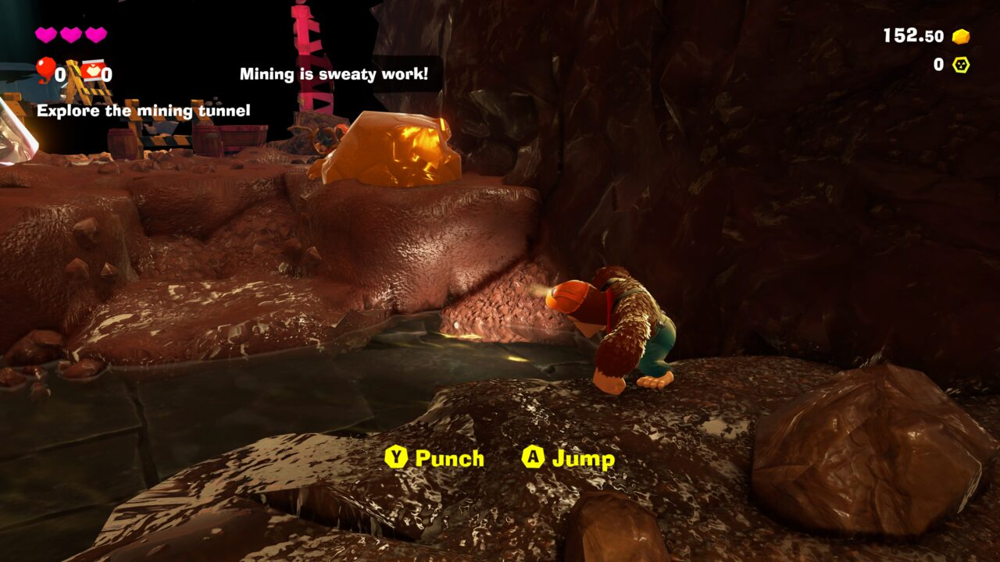
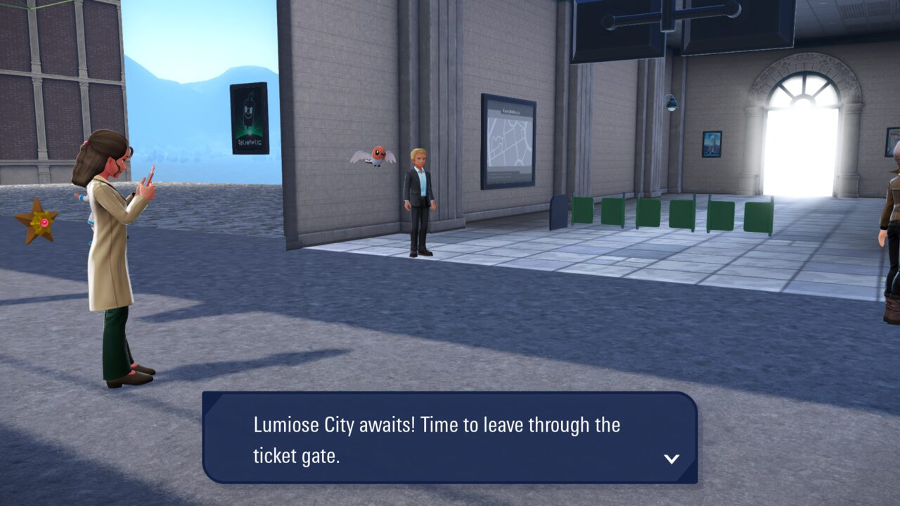
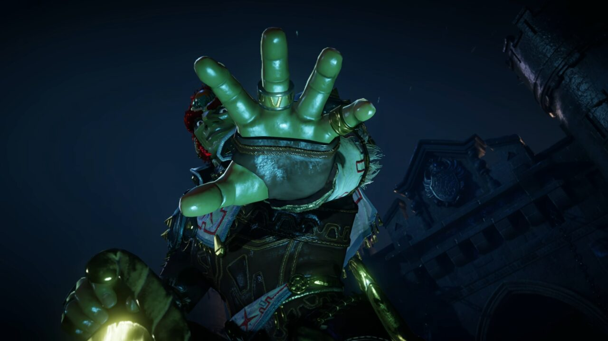

# Switch2RECOMP Turbo

Turn your own Switch and Switch 2 game dumps into native Windows and Linux games.

This is an enhanced fork of SwitchRecomp by MZ Labs, maintained by [ChrisColeTech](https://github.com/ChrisColeTech).
It is a recompiler, not an emulator: the game's code is translated once, ahead of time, into a real program for your PC.

> [!IMPORTANT]
> No games, keys or firmware are included. Use your own legally obtained dumps and console keys.

## Games

| | |
| --- | --- |
| **Mario Kart World**  Plays at about 58–59 FPS, with occasional stutters | **Mario Kart 8 Deluxe**  Plays at 60 FPS, including Booster Course Pass DLC |
| **Donkey Kong Bananza**  Plays at 52–60 FPS, with some slowdowns and stutters | **Pokémon Legends: Z-A**  Plays, but held at 30 FPS |
| **The Legend of Zelda: Ocarina of Time**  Title screen and opening movie work; gameplay doesn't yet | |

60 FPS is the goal, not yet a guarantee. Measured numbers are in the [technical details](docs/TECHNICAL.md#measured-performance).

## What's different in Turbo

- **Build straight from your dump.** NUP and NSP packages work directly; no unpacking, and the game data stays in the
  original file. That includes an NSP that holds a game together with its update and DLC (1G+1U, 1G+1U+1D).
- **DLC support.** Install add-on content from NSP, NSZ, XCI, XCZ and NCA files.
- **Native graphics.** Switch graphics run on Vulkan, with a shader cache so games get smoother the more you play.
- **Video and sound.** In-game movies (VP9 and AV1) and Opus audio play, which several games need to get past their
  intros.
- **PlayStation controllers on Windows.** DualSense and DualShock 4 work, with player lights and rumble.
- **Built-in diagnostics.** Each game logs its frame rate, so problems can be measured instead of guessed at.

The full list is in the [technical details](docs/TECHNICAL.md#what-turbo-adds).

## How to use it

The easiest way is **RecompLauncher**, a desktop game library built on this engine: add your dump, click Build,
then Play. It ships everything a build needs in one download.

You can also use the engine directly from the command line; see [technical details](docs/TECHNICAL.md).

## Learn more

- [Technical details](docs/TECHNICAL.md): what the fork adds, performance numbers, building from source, renderers
- [Player manual and settings](README.txt)
- [Developer guide](DEVELOPER_GUIDE.md)

## Credits and license

**SwitchRecomp by MZ Labs. Copyright 2026 MZ Labs.** Turbo fork maintenance and modifications: **ChrisColeTech**.
This README describes the modified fork as of November 18, 2026; original authorship remains with the credited authors.

The project is distributed under [GNU AGPL v3](LICENSE.txt) with the additional terms in [NOTICE.txt](NOTICE.txt).
Preserve those notices, the MZ Labs credit, and the unchanged, readable SwitchRECOMP startup logo/copyright screen
when distributing copies or modified builds. Eden components retain their GPL-3.0-or-later notices; other third-party
components retain their own licenses.

Credits include Mythrax-ZS, nxnative/seedds, pokopia-native, Eden/Eglantine, Lichii, Mesa, Ryujinx and the library
authors listed in [NOTICE.txt](NOTICE.txt), [third-party notices](docs/THIRD_PARTY.md) and [README.txt](README.txt).
