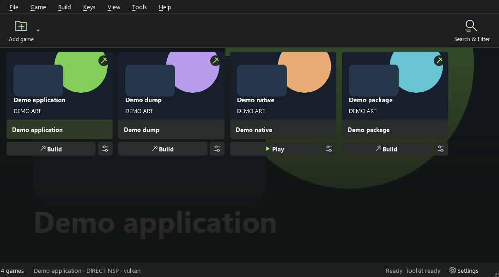
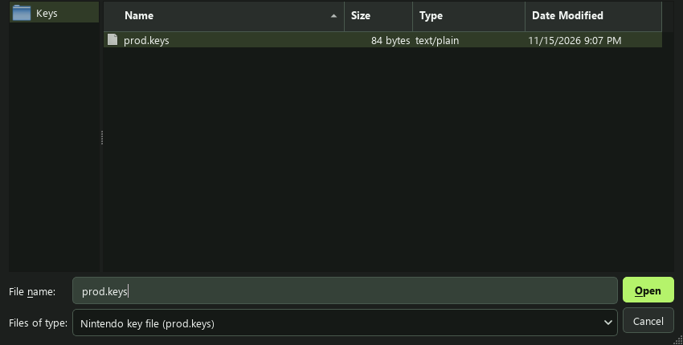
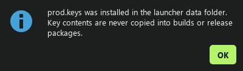
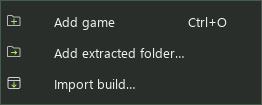
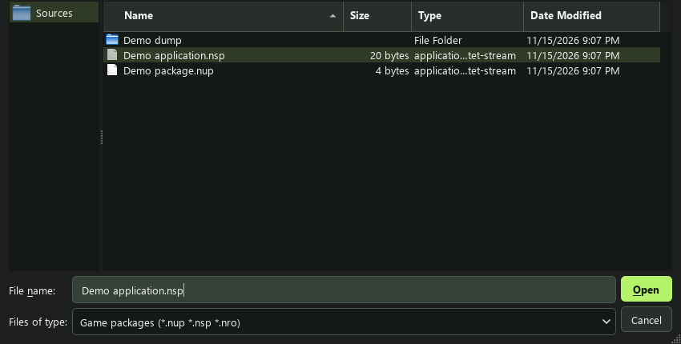
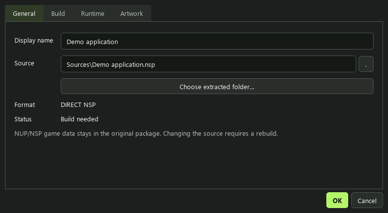
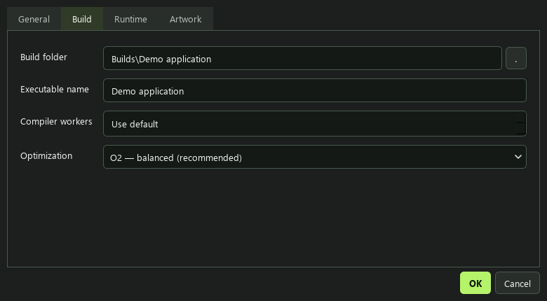
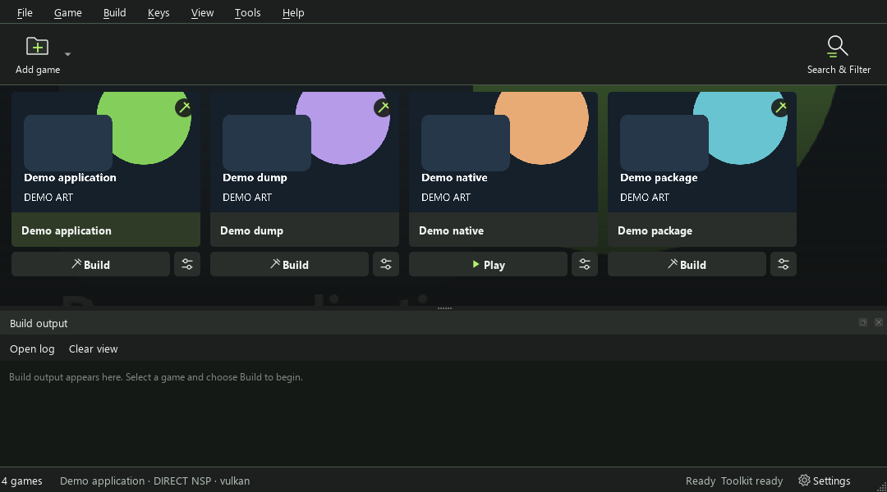
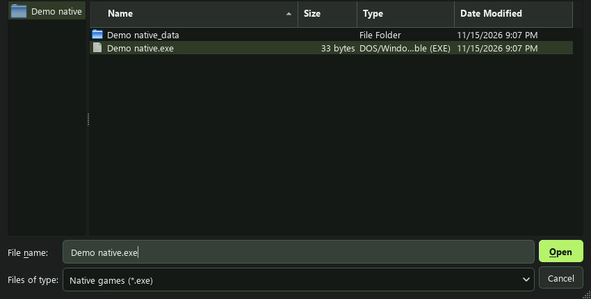
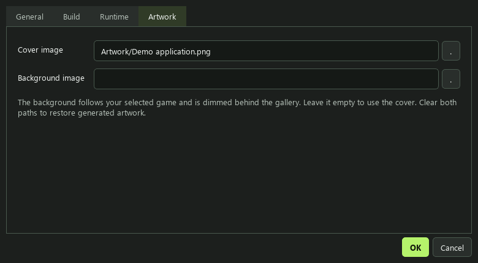

# Switch2RECOMP Turbo

**An enhanced fork maintained by [ChrisColeTech](https://github.com/ChrisColeTech).** This is a modified version of
SwitchRecomp, not the vanilla upstream release. It is a **static recompiler and build/library utility**, not an
emulator product: ARM64 game code is translated to C and compiled into a native Windows or Linux module. The
runtime supplies Horizon OS services and graphics compatibility.

**[Download the latest release](https://github.com/ChrisColeTech/Switch2RECOMP-turbo/releases/latest)** ·
[Platform requirements](docs/RELEASES.md#run-a-release) · [Launcher details](docs/LAUNCHER.md)

No games, keys, or firmware are included. Use your own legally obtained dumps and console keys.



*Real Qt widget captures with clearly named demonstration entries and original demo artwork. The sample packages,
native artifacts, and key file are nonfunctional fixtures, not bundled games or proof of game compatibility.
[Capture method and verification](docs/LAUNCHER.md#screenshot-capture-and-nsp-verification).*

## Start the launcher

1. Extract the **whole** Windows ZIP or Linux tar.gz from the release page into a writable folder.
2. Windows: open **`Switch2RECOMP-turbo.cmd`**. Linux: run **`./Switch2RECOMP-turbo.sh`**.
3. Check **Tools > Settings > Toolkit** if the status bar says **Setup needed**. Keep the toolkit files together.

The portable bundles carry the build tools. Source checkout? Build just the Qt frontend with
`scripts\build-launcher.bat` on Windows or `sh scripts/build-launcher.sh` on Linux, then run
`bin/launcher/SwitchRecompLauncher.exe` or `bin/launcher-linux/SwitchRecompLauncher`.
See [launcher build prerequisites](docs/LAUNCHER.md#build-the-launcher); building the frontend alone does not build the runtime.

## Install your keys for NSP builds

Choose **Keys > Install keys…**, select your own `prod.keys`, and click **Open**. The launcher keeps a private
copy in its application-data folder. Key contents are not copied into game builds or releases.





The confirmation means the file was installed, not that its keys can decrypt every package.
[NSP layout and key requirements](docs/NSP_IN_PLACE.md).

## Add a package or dumped folder

Use **Add game** or its dropdown. Drag-and-drop also accepts supported sources.



| Your input | Choose |
| --- | --- |
| Indexed `.nup` | **Add game**, then select the package |
| Supported application `.nsp` | **Add game**, then select the package; install keys before building |
| Dumped folder | **Add extracted folder…**; select a folder containing `exefs/main`, `ExeFS/main`, or `main` |
| Homebrew `.nro` | **Add game**, then select the NRO |
| Already built EXE / Linux executable | **Import build…** ([below](#import-an-already-built-game)) |



**Yes, the launcher accepts NSP.** Direct NSP builds currently require a PFS0 application package with an NCA3
Program archive, plaintext PartitionFS ExeFS and plaintext IVFC RomFS. Encrypted filesystem sections, rights-managed
data, sparse/compressed layouts and BKTR update-only packages are unsupported.
[NSP limitations](docs/NSP_IN_PLACE.md#supported-packages) · [Indexed NUP requirements](docs/NUP_IN_PLACE.md).

Set the display name, check the source, then choose **Add game** in the new-entry dialog. Later, use the card's
sliders button or **Alt+Enter** to reopen **Properties** (shown below).



## Build, then play

1. In **Properties > Build**, choose a writable build folder. Start with **O2**; **Use default** inherits the global worker count.
2. In **Runtime**, choose **Vulkan** or **OpenGL**, then save with **OK**.
3. Click the card's **Build** button (or **Ctrl+B**). Read progress in the build-output dock.
4. After a successful build, click **Play**. Double-click or Enter also launches a ready game without recompiling it.





**Ctrl+L** reopens build output. **Cancel build** stops compilation; a failed/cancelled build needs rebuilding.
Vulkan requires the runtime's NVN support, shader tools, Python and .NET 10 (included in the portable bundles).
Keep the original NUP/NSP at its imported path: the runtime reads game data directly from it.

## Import an already-built game

Choose **File > Import build…** and select the game's EXE, or its extensionless Linux executable.
Keep the matching `<Name>_code.dll` / `<Name>_code.so` and `<Name>_data/` beside it.
**File > Discover builds…** scans a folder and its immediate subfolders. Importing does not compile or launch anything.



## Add cover art and a background

Open **Properties > Artwork**. Use **…** beside **Cover image** or **Background image**, choose an image, then **OK**.
PNG, JPEG, WebP and BMP are supported. Keep the image files where you selected them.



An empty background uses the cover. Toggle the backdrop in **View > Show selected game background**.
**Search & Filter** contains search, sorting, gallery/list views and card size; **Settings > Appearance** changes the theme.

## What Turbo adds

The fork brings the Qt library/build workflow and portable tooling together with native NVN/Vulkan work,
shader-cache and frame-time diagnostics, and Windows controller work for DualSense/DualShock 4 input, player lights
and classic rumble. Physical output verification remains pending; see [controller status](docs/CONTROLLERS_WIN32.md).
The runtime also has queued stereo audio with smooth slowdown; some Switch 2 audio/video paths remain incomplete.

**60 FPS is a target, not a guarantee.** The documented integrated Mario Kart World race measured **58.4 FPS
(presentations/s), with stutters**. Stable minimum 60 FPS has not been achieved.
[Measurements and remaining bottlenecks](docs/MKW_PERFORMANCE_INVESTIGATION.md).

<details>
<summary><strong>Reference: source builds, CLI commands and technical docs</strong></summary>

### Build from source

Run commands from the repository root. Full setup: [build environment guide](docs/BUILD_ENVIRONMENT_GUIDE.md).
Qt frontend requirements and commands: [launcher guide](docs/LAUNCHER.md#build-the-launcher).

Linux dependencies (Debian/Ubuntu names):

```sh
sudo apt install build-essential python3 libsdl2-dev libx11-dev libgl-dev libegl-dev \
    mingw-w64 gcc-mingw-w64-x86-64-win32 cmake ninja-build glslang-tools
```

The Windows cross-build uses the win32 thread model of `x86_64-w64-mingw32-gcc`.
Build either optional Vulkan library before its runtime:

```sh
python3 tools/build_nvn.py              # Windows: build/nvn/libnvn.a
python3 tools/build_nvn.py --linux      # Linux: build/nvn_lin/libnvn.a

cmake -S runtime/edenvk -B runtime/edenvk/build -G Ninja && ninja -C runtime/edenvk/build
cmake -S runtime/edenvk -B runtime/edenvk/buildw -G Ninja \
      -DCMAKE_TOOLCHAIN_FILE=runtime/edenvk/mingw.cmake && ninja -C runtime/edenvk/buildw
# For Eden, copy libedenvk.a and libsirit.a into runtime/edenvk/lin/ or runtime/edenvk/win/.
```

`tools/build_nvn.py` expects Vulkan-Headers in `external/deps/Vulkan-Headers` or `VULKAN_SDK`.
Without an optional renderer library, the runtime builds with the remaining renderers.

```sh
python3 switchrecomp.py --build-runtime --target win64 --backend win32 --cc x86_64-w64-mingw32-gcc
python3 switchrecomp.py --build-runtime --target linux --backend x11   --cc gcc
```

Runtime outputs go to `bin/`. On Windows, use the checkout's `.venv\Scripts\python.exe` when available.
The toolkit prefers explicit `SWR_PYTHON`, then `.venv`, `venv`, bundled Python, and PATH.

### Recompile from the command line

```sh
python3 switchrecomp.py /path/to/game -o MyGame
python3 switchrecomp.py /path/to/game.nup -o MyGame
SWR_PROD_KEYS=/path/to/prod.keys python3 switchrecomp.py /path/to/game.nsp -o MyGame
```

The folder input may contain `exefs/` and `romfs/`. Direct package builds materialize ExeFS and read RomFS
from the original supported package. Import the resulting native executable into the launcher to play it.

### Renderers

| Game INI value | Renderer |
| --- | --- |
| `renderer=opengl` | Runtime GPU emulation with GLSL translation |
| `renderer=vulkan` | Native NVN calls rendered with Vulkan; live SPIR-V shader translation |
| `renderer=eden` | Runtime command processing through Eden's Vulkan GPU (separate optional source build) |

All three have Windows/Linux implementations. The Qt launcher offers Vulkan and OpenGL; new library entries
default to Vulkan. Vulkan caches translated shaders in `<game>_nvn/cache`.
On Linux its low-address mapping currently requires `sudo sysctl vm.mmap_min_addr=0` for games that expect
zero-filled reads through NULL pointers; this changes a system-wide protection. See [runtime instructions](README.txt).

### Further reading

- [Player manual and INI options](README.txt)
- [Code layout, diagnostics and developer guide](DEVELOPER_GUIDE.md)
- [Changelog](CHANGELOG.txt) and [regression checks](REGRESSION.md)
- [Portable release layout, tests and packaging](docs/RELEASES.md)
- [Direct NUP](docs/NUP_IN_PLACE.md) and [direct NSP](docs/NSP_IN_PLACE.md)

</details>

## Credits and license

**SwitchRecomp by MZ Labs. Copyright 2026 MZ Labs.** Turbo fork maintenance and modifications: **ChrisColeTech**.
This README describes the modified fork as of November 15, 2026; original authorship remains with the credited authors.

The project is distributed under [GNU AGPL v3](LICENSE.txt) with the additional terms in [NOTICE.txt].
Preserve those notices, the MZ Labs credit, and the unchanged, readable SwitchRECOMP startup logo/copyright screen
when distributing copies or modified builds. Eden components retain their GPL-3.0-or-later notices; other third-party
components retain their own licenses.

Credits include Mythrax-ZS, nxnative/seedds, pokopia-native, Eden/Eglantine, Lichii, Mesa, Ryujinx and the library
authors listed in [NOTICE.txt](NOTICE.txt), [third-party notices](docs/THIRD_PARTY.md) and [README.txt](README.txt).
